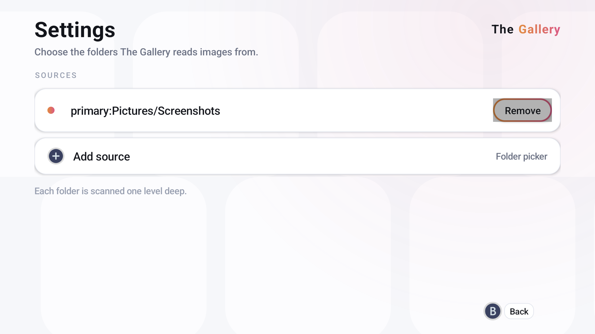

  

# The Gallery

An image gallery for Android handhelds. The code was entirely vibe coded with AI; apart from the interaction design and this README, there is hardly any human work in this project.

## Why

I love to take screenshots when play games. But many gallery apps cannot be fully operated with a game controller: you are constantly forced to reach for the touchscreen; and they often come with annoying media-management rules. So I made a gallery that can be operated **entirely with a controller**, **no more touchscreen**.

## Controller Controls

Follow the prompts in the lower-right corner. Short presses can trigger some common actions, some other actions live in hold menus, you can try to hold buttons.

If the hold delay feels too long, press the corresponding D-pad direction as soon as you start holding the button. It responds as well. Yes, you actually do not need to wait for the D-pad wheel hint to appear.

Some actions are a little hidden: hold **Up** and press **X** to jump to the top, or hold **Down** and press **B** to jump to the bottom. This feels intuitive on a Nintendo Switch layout. I might tweak for other button layouts in the future.

_The operation scheme is designed to feel like a game, I hope it feels good to you._

## Managing Your Gallery

The current setup is simple: add image source folders in Settings page, so you can combine screenshots from multiple emulators. **Each folder is not scanned recursively, for now.**

## Sharing Images

The Gallery can share selected images over the **local network**, so you can use another device to receive and post them. Most people do not install social apps on their handhelds (at least I don't, to not break the gaming vibe).

If you use your own router, you can assign the handheld a static IP address. Then the sharing address then will always stay the same, so you can bookmark it.

This works pretty well, but I may add other ways to share, in the future.

## Recommendation

### [iiSU](https://github.com/iisu-network/iiSU)

**iiSU** is a beautiful and handy launcher app, I've been using it for a long time. I studied its visual style so that using **iiSU** and **The Gallery** together feels more immersive.

> May you happy playing games. If you have any problem or suggestion, feel free to open an issue or PR.
