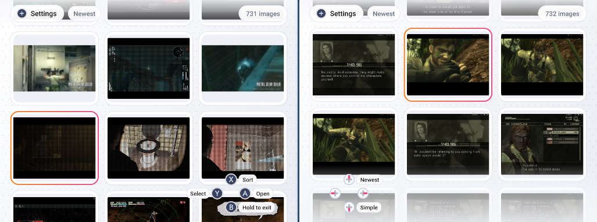
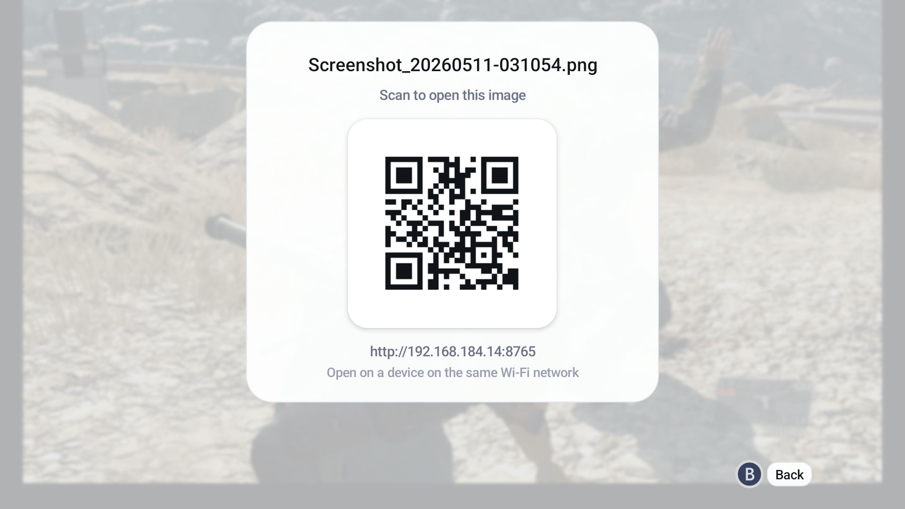

  

# The Gallery

An image gallery for gaming Android handhelds.

_The code was entirely vibe-coded with AI. Apart from the design and this README, there is hardly any human work in this project. So I sincerely suggest you read the README first._

## Why

I love to take screenshots when playing games. But many gallery apps are not good with a handheld device:
- They cannot be fully operated with a game controller, you are constantly forced to reach for the touchscreen.
- They often come with annoying media-management rules, while I just want to view pictures in a few specific directories.

So I made a gallery app that can be operated **entirely with a controller**, **no more touchscreen**.

## Use

Follow the prompts in the lower-right corner. Presses X/Y/A/B can perform some common actions, holding them opens a radial menu with some other actions or toggles.

If you feel the holding delay is too long, you don't actually need to wait for the wheel to show up, you can input direction immediately after you start holding.

In the full-screen viewer, press **Up** to zoom in and **Down** to zoom out (hold a direction to keep zooming); zooming snaps onto best fit and 100% and shows the current scale. Use either stick to move the image once it is larger than best fit, press **B** to restore best fit, and press **A** to show or hide a translucent details layer. The viewer keeps its prompts hidden until you press a face button.

Some actions are a little hidden: hold **Up** then press **X** to jump to the top, or hold **Down** then press **B** to jump to the bottom. This feels intuitive on a Nintendo Switch layout. I might tweak the scheme for other button layouts in the future.

_The control style is designed to make it feel like a game, I hope it feels good to you._

## Gallery Management

The current setup is simple: add image source folders in Settings page, so you can combine screenshots from multiple emulators. **The folders are _not_ scanned recursively, for now.**

  

## Sharing Images

We can share selected images over the **local network**, so you can use another device to receive and post them. Most people do not install social apps on their handhelds (at least I don't, to not break the gaming vibe).

  

If you use your own router, you can assign the handheld a static IP address. Then the sharing address will always stay the same, so that you can bookmark it.

This works pretty well, but I may add other ways to share, in the future.

## Recommendation

### [iiSU](https://github.com/iisu-network/iiSU)

**iiSU** is a beautiful and handy launcher app, I've been using it for a long time. I studied its visual style so that using **iiSU** and **The Gallery** together feels more immersive.

---

> May you happy playing games. If you have any problem or suggestion, feel free to open an issue or PR.
